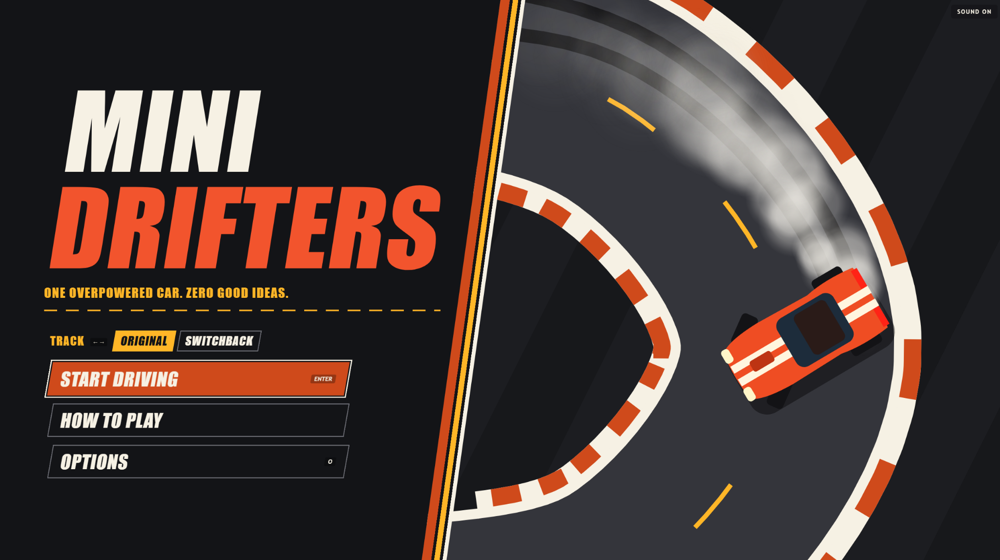
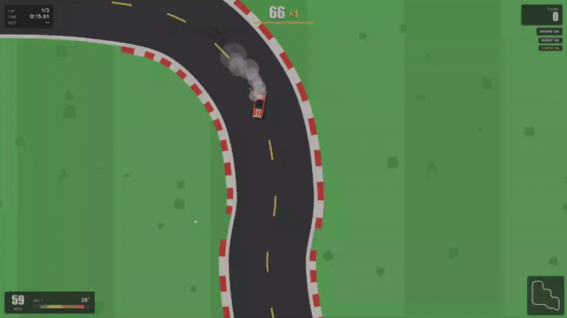

# Mini Drifters

A tiny top-down arcade drifting game for the browser. Race a small muscle car around a circuit, throw it sideways with the handbrake, and earn points for keeping it there.

## [▶ Play Mini Drifters](https://libertaine.github.io/mini-drifters/)

It runs in a desktop browser with a keyboard or a standard-mapped controller (controller driving has passed owner review). There's nothing to install and no account to create.



## Gameplay preview



## Status

**Early playable prototype.** Mini Drifters is here to find out whether the driving is fun, and it isn't feature-complete. There is one car, and handling and scoring may change. The current release is [v0.2.0](https://github.com/libertaine/mini-drifters/releases/tag/v0.2.0). It adds Switchback, a more technical circuit with linked corners and tighter drifting opportunities, alongside Original, as well as analog controller support and per-track personal bests saved in your browser. It also stops shortcuts and voided laps from adding to your score. Prototype 0.1 was released as [v0.1.0](https://github.com/libertaine/mini-drifters/releases/tag/v0.1.0) with one track. See the [roadmap](docs/ROADMAP.md) for what might come next.

## Controls

| Key | Action |
|---|---|
| Up | Accelerate |
| Down | Brake, then reverse when nearly stopped |
| Left / Right | Steer |
| Space | Handbrake |
| R | Restart |
| P | Pause |
| G | Show or hide the ghost |
| N | Next radio station |
| O | Options, from the title, pause or results screen |
| H | Next handling mode, on the title (Shift+H goes back) |
| D | Debug display |

Enter also starts a run from the title and results screens.

On the title screen, Up, Down and Tab move through the menu, and Enter or Space presses the selected button. Up from **Start driving** reaches the handling choice. **How to Play** has the controls and scoring, and Esc goes back.

### Controller

Standard-mapped Xbox-style controllers are the initial target; PlayStation controllers
can work through the browser's standard mapping. Press a button with the page focused,
then release all controls before using it. Compatibility depends on browser and OS.

| Controller | Action |
|---|---|
| Left stick | Analog steering |
| RT / LT | Analog accelerator / Brake, then reverse |
| A | Handbrake while driving; Confirm in menus |
| B | Back / Close; Resume from Pause; Title from Results |
| Menu / Start | Pause / Resume |
| D-pad | Menu navigation; Left/Right selects track (or handling, when it's focused) or adjusts Options |
| X / Y | Toggle ghost / Next radio station while driving |

Use the pause menu for Restart, Return to Title and tutorial Skip. Keyboard driving
keys take priority while held; release the controller to neutral before taking over.
Release all controller controls between screens and before resuming. Losing the driving
controller pauses; reconnecting never resumes automatically. An unused controller's
disconnection leaves keyboard driving alone.

HTTPS or localhost is recommended. Missing/denied Gamepad API access retains keyboard
and mouse controls. Some browsers need one click or key press to unlock audio even
when gamepad driving works. See [controller notes and physical testing steps](docs/CONTROLLERS.md).
There is no remapping, vibration or universal hardware compatibility claim.

### Choosing a track

The title screen has a **Track** choice under the tagline: **Original** or **Switchback**. Press Left or Right to change it, or click one, then start as usual.

- A new visit starts on Original, and the choice isn't saved.
- Restart and Drive Again stay on the same track. Use **Return to Title** to change it.
- Changing track starts a fresh run, with no score, laps or ghost carried over.
- The Try It lesson always uses Original.

Switchback trades Original's long bends and hairpin for a staircase of linked medium corners and one tight right. See [the Switchback notes](docs/SWITCHBACK.md).

### Choosing handling

Under the track is a **Handling** choice, with a one-line description of each:

- **Classic**: familiar, handbrake-focused drifting with forgiving handling. This is the handling of v0.2.0 and earlier, unchanged.
- **Power**: break rear traction with throttle. More control, more consequences. At lower speeds the throttle can spin the rear wheels and start a slide, and the pedal sets the angle; the handbrake still works too.

Neither is the "right" one: they are two ways to drive the same car.

Press **H** (Shift+H goes back), click one, or press Up from **Start driving** and then Left or Right. On a controller, D-pad Up from Start driving reaches it.

- A first visit starts on Classic. After that the game remembers the handling you chose last, in this browser.
- A run keeps its handling through Restart and Drive Again. Use **Return to Title** to change it.
- The HUD names the handling, and the results say which track and handling the run used.
- The Try It lesson always uses Classic, because it teaches the handbrake technique. How to Play says so, and the lesson doesn't change your chosen handling.
- Each track and handling pair keeps its own personal bests (below). Scores from different handling modes aren't comparable.

### Practice pad

**Practice pad** on the title opens a square of open asphalt with a few cones: a ring to circle, a figure-eight, a gate to turn back through and a slalom. It uses the chosen handling. There are no laps, score, ghost or records, and nothing is timed or saved. R puts the car back, P pauses, and Esc goes back to the title.

**Return to Title** is on the pause and results screens, so leaving a run no longer takes a reload.

The **Sound** button under the score is the master switch for all sound, and remembers your choice. It works with the mouse, or with Tab and Enter.

**Options** has the radio station, music volume and sound effects volume, all remembered between visits. The radio is off by default. Its three stations play [provisional built-in music](docs/RADIO.md), which may be replaced later.

### How to drift

1. Steer into a corner and pull the handbrake for about a quarter of a second, until the tail steps out.
2. Stay on the throttle and steer the other way to hold the slide.
3. Lift off the throttle to straighten up.

The longer you pull, the bigger the slide. A very short tap only unsettles the car, and holding the handbrake spins it.

### Try It

**Try It** on the How to Play screen starts an optional five-step lesson: accelerate, steer, start a slide, countersteer and bank the points. It's the real car, track and scoring, there's no time limit, and each step waits until you've really done it. The lesson always drives Original with Classic handling, whatever you've chosen on the title, and leaves your choice as it was.

While you're in the lesson, Esc leaves it, R goes back to the grid and keeps your place, and P pauses. The pause screen can also skip a step. A lesson records no ghost, and nothing from it carries into your next run.

## Gameplay

**Sessions.** A run is three counted laps. The clock starts when you first press a pedal, and the end screen shows your score, best lap, total time, highest combo and spinouts.

**Drift scoring.** Sliding at speed on the road builds unbanked points. Bigger angles and higher speeds earn more, up to a point: the best angles are 25° to 50°, and hanging on to the handbrake earns much less than sliding under power. Only ground you haven't covered yet pays, so donuts, repeat passes and cutting back across the infield earn nothing.

**Combos.** Keep drifting, link drifts within two seconds, or flick from one side to the other to climb the multiplier from ×1 through ×1.5 and ×2 to ×3. The multiplier applies to the whole combo when it's banked.

**Spinouts and penalties.** Straighten up and the combo banks into your score. If you spin past 75°, hit the wall hard, stay on the grass for more than 1.5 seconds or stop making progress, you lose the unbanked combo. Points you've already banked are safe, unless the lap is voided.

**Ghost.** After your first valid lap, a translucent blue car replays your previous valid lap so you can race it. It can't touch you and doesn't affect your score or lap times, and G hides it. A restart clears it. This is an experiment: see [the ghost notes](docs/GHOST.md).

**Lap timing.** A lap counts only if you pass every checkpoint in order. Cutting across the grass voids that lap, and timing restarts at the finish line so you never have to turn back. Your best valid lap is kept for the run. Running wide on the outside of a corner costs time but doesn't void the lap. A voided lap scores nothing: the points you banked on it come off your score at the line, and a combo still running there is lost. You're warned as soon as the missed checkpoint is detected, at the next one you cross. The run still ends after three counted laps, and the results show any laps that weren't counted.

### Personal bests

Each track and handling pair (for example Original with Power) keeps three local records: highest final score and best
banked combo from a completed three-lap run, counting only the laps that counted, plus
the fastest valid lap. A valid lap
is saved as it finishes even if you later restart or leave the run; voided and
incomplete laps never count. Abandoned runs do not set score or combo records,
and Try It lessons and the practice pad never set any records.

The title shows the saved bests for the selected track and handling (`--` until set).
Records saved by v0.2.0 appear under Classic. Results mark
saved improvements with `NEW BEST`. Records use this browser/device's localStorage;
they persist across reloads and browser restarts. Clearing browser storage removes
them. They are not an online leaderboard and do not sync between browsers or devices.
If storage is unavailable or full, driving continues and a note explains that new
improvements cannot be saved; the displayed records remain the last saved values.
See [the records schema and acceptance steps](docs/RECORDS.md).

## Development

The game is plain HTML, CSS and JavaScript on a Canvas, with no build step and no runtime dependencies. You need [Node.js](https://nodejs.org/) 22 or newer to run the local server and tests. CI uses Node 24.

### Run locally

On Windows, double-click **`Start Game.cmd`**. It starts a local server and opens the game. Leave its window open while you play, and close it to stop.

Anywhere else:

```
node server.mjs
```

Then open <http://127.0.0.1:4190>.

For the separate, development-only engine and tire listening bench, open
<http://127.0.0.1:4190/audio-lab/>. See [the audio lab notes](docs/AUDIO-LAB.md)
for controls, sample licenses, comparison limits and listening checks. The lab
is excluded from Pages and does not connect to the driving game.

The game plays recordings of the project owner's Mustang with a CC0 tire recording, and
falls back to a synthesized engine if the recordings can't load. See
[the gameplay audio notes](docs/GAMEPLAY-AUDIO.md) for how to listen and how the sound
responds to the car.

### Test

```
npm test
```

This runs the physics, scoring, lap, track, session, ghost, tutorial, controller, local records, audio, radio and publishing tests.

`npm run test:controller:browser` checks mocked Gamepad snapshots and controller menus in Chromium and Firefox; physical hardware is not required by CI.

The browser check drives the game with real key presses in Chromium and Firefox, served the same way as on GitHub Pages. It needs Playwright, which the game itself doesn't depend on:

```
npm install --no-save --no-package-lock playwright@1.64.1
npx playwright install chromium firefox
npm run test:browser
```

To run the same check against the live site, set `TEST_URL=https://libertaine.github.io/mini-drifters/` first. It also confirms the live files match your checkout.

`npm run test:tutorial:browser` plays the whole lesson with real key presses at each supported window size. It takes a few minutes.

`npm run test:tracks:browser` checks the track choice and drives a lap of Switchback with real key presses. It also takes a few minutes.

`npm run test:records:browser` checks per-track saving, reloads, qualification, storage failures and controller navigation in Chromium and Firefox.

`npm run test:handling:browser` checks choosing handling by keyboard, mouse and controller, remembering the choice, the practice pad, the lesson staying on Classic, records kept apart by handling, and the migration of v0.2.0 records, in Chromium and Firefox.

Screenshots and a report go to `artifacts/`, which isn't tracked.

Changes reach `main` through a pull request, and the `test` check must pass before it can merge.

### Project layout

| Path | Contents |
|---|---|
| `src/tuning.js` | Every handling and scoring number, with comments |
| `src/physics.js` | The car |
| `src/handling.js` | The handling modes: each one a named, fixed set of car tuning |
| `src/handling-preferences.js` | Remembers the last chosen handling mode |
| `src/practice-pad.js` | The practice pad's surface and markers |
| `src/track.js`, `src/laps.js` | The two circuits and lap validation |
| `src/scoring.js` | Drift detection and combos |
| `src/records.js` | Local personal bests by track and handling, run qualification, and reading v0.2.0's records |
| `src/ghost.js` | Recording and replaying the previous valid lap |
| `src/game.js` | The session, on a fixed 120 Hz timestep |
| `src/tutorial.js` | The driving lesson. It watches a session and never writes to it |
| `src/render.js`, `src/main.js` | Drawing, input and the HUD |
| `src/audio.js`, `src/audio-telemetry.js` | Sound, and how the car's telemetry maps to it |
| `src/audio-voices.js`, `src/coyote.js`, `src/coyote-model.js` | Engine and tire voices, shared with the audio lab |
| `src/radio-stations.js`, `src/radio.js`, `src/audio-preferences.js` | Station and track data, music playback and saved sound settings |
| `radio/` | Radio audio and its attribution |
| `test/` | Automated tests and the scripted drivers they use |

Press D in the game to see live slip angles, grip, drift qualification and checkpoint progress.

### How the car works

The car is a lightweight two-axle model. Heading and velocity are separate, and slides come from tyre forces rather than animation.

- **Handbrake:** this lowers rear grip rather than rotating the car, so it does nothing to a car driving straight or parked.
- **Throttle in a slide:** once the rear has broken loose, throttle keeps it loose and lifting lets it hook back up. Throttle sets the angle, and steering sets the direction.
- **Countersteer:** steering toward a slide earns extra wheel angle, which lets the rear catch up.
- **Arcade help:** the front wheels trail the slide slightly, and a mild pull straightens the nose past 48° of slip unless the handbrake is held.
- **Power handling** (internal id `revised`) adds one thing: the rear tyres share a grip budget between driving and cornering, and asking for more throttle than they can take, below about 29 m/s, spins the wheels up gradually. Spinning wheels corner less well. Classic never enters this code.

### Tuning

These values in `src/tuning.js` have the most effect on feel. They are Classic's, and the other handling modes in `src/handling.js` start from them:

| Constant | Effect |
|---|---|
| `rearPowerSlideGrip` | The most important one. Lower makes drifts easier to keep but quicker to spin. Below about 0.64, even a 0.1 s tap becomes a full slide. Higher values make slides die sooner. |
| `handbrakeLateralGrip`, `handbrakeEngageRate` | How hard and how quickly the handbrake lets go of the rear |
| `driftRecovery` | How quickly rear grip returns on release |
| `yawDamping`, `yawInertia` | How eagerly the car rotates, and how quickly rotation settles |
| `counterSteerAuthority`, `casterAssist` | How forgiving catching a slide is |

Several tests check that drifts stay holdable and that controlled driving out-scores handbrake abuse, so run them after changing these. `test/handling.test.mjs` pins every handling mode's numbers, because records are only comparable while they hold: a change big enough to matter should get a new mode id, not new numbers under the old one.

## Known limitations

- Grass affects the whole car at once, based on its centre, so there's no two-wheels-off behaviour.
- The only barrier is a simple perimeter wall.
- Fishtailing down a straight still scores. It costs speed, but it isn't prevented.
- A careful driver can occasionally slide by accident and score, and a bad drifting run can score less than a good reckless one.
- Drifting is slower than grip driving in the scripted test runs, so points and lap time pull in different directions.
- Desktop keyboard and standard-mapped controllers are supported. The track choice is not saved; the handling choice and personal records stay local to this browser/device.
- Records are saved to a new storage key from v0.3.0. If an older version is opened, it shows only the records it saved itself. Nothing is lost, and the newer version shows both.
- Scoring was tuned for Classic. Power uses the same scoring rules, so its scores aren't comparable with Classic's, and each keeps its own records.
- The Try It lesson teaches Classic only. A lesson for Power's throttle technique may come later.
- Owner review covered controller driving and drifting on both tracks; every physical disconnect/reconnect scenario was not explicitly verified.

## License

The code is [MIT](LICENSE). The audio recordings aren't: see [LICENSE-AUDIO.md](LICENSE-AUDIO.md).
In particular, the Mustang engine recordings are owned by the project owner, distributed
with Mini Drifters by permission, and not licensed for other uses.
