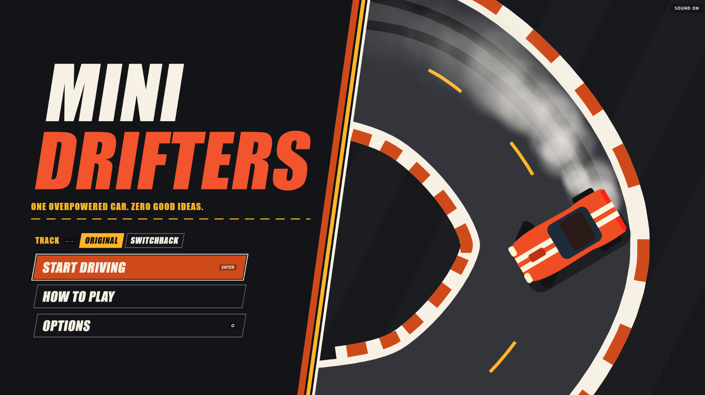
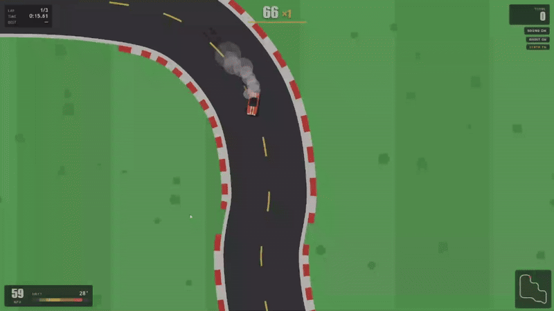

# Mini Drifters

**One overpowered car. Zero good ideas.**

A small top-down arcade drifting game for the browser. Throw a muscle car sideways with the handbrake, keep it there, and earn points for the trouble.

## [▶ Play Mini Drifters](https://libertaine.github.io/mini-drifters/)

It runs in a desktop browser with a keyboard or a standard-mapped controller. There's nothing to install and no account to create.

**Current version: [v0.5.0](https://github.com/libertaine/mini-drifters/releases/tag/v0.5.0).** Earlier versions and their changes are on the [Releases page](https://github.com/libertaine/mini-drifters/releases).





## What's in it

Mini Drifters is an early playable prototype: one car, built to find out whether the driving is fun. Handling and scoring may still change. It has:

- **Three circuits:** Original, Switchback and Dockyard, each a three-lap run scored on drifting.
- **Four Gymkhana challenges:** Precision 180, Linked Drift, One Drift and Slalom Sprint.
- **Two handling modes:** forgiving Classic, and Power, where the throttle can break the rear loose.
- **Personal bests** for every track and handling pair, and for every challenge, kept in your browser.
- **A ghost** of your previous valid lap to race.
- **An optional driving lesson** and an unscored **practice pad**.
- **Recorded engine sound** and a **three-station radio** with provisional music.

There are no online leaderboards, multiplayer, medals or saved ghosts.

## Getting started

1. Open the [game](https://libertaine.github.io/mini-drifters/) in a desktop browser.
2. Choose a track and a handling mode on the title screen, then press Enter.
3. New to it? **How to Play** has the controls and scoring, and its **Try It** button starts a short lesson.

### Keyboard

| Key | Action |
|---|---|
| Up | Accelerate |
| Down | Brake, then reverse when nearly stopped |
| Left / Right | Steer |
| Space | Handbrake |
| R | Restart |
| P | Pause |
| G | Show or hide the ghost |
| N | Next radio station |
| O | Options, from the title, pause or results screen |
| H | Next handling mode, on the title (Shift+H goes back) |
| D | Debug display |

Enter also starts a run from the title and results screens, and tries a Gymkhana challenge again from its results.

On the title screen, Up, Down and Tab move through the menu, and Enter or Space presses the selected button. Up from **Start driving** reaches the handling choice. Esc goes back.

**Return to Title** is on the pause and results screens.

### How to drift

1. Steer into a corner and pull the handbrake for about a quarter of a second, until the tail steps out.
2. Stay on the throttle and steer the other way to hold the slide.
3. Lift off the throttle to straighten up.

The longer you pull, the bigger the slide. A very short tap only unsettles the car, and holding the handbrake spins it.

### Try It and the practice pad

**Try It** starts an optional five-step lesson: accelerate, steer, start a slide, countersteer and bank the points. It's the real car, track and scoring, there's no time limit, and each step waits until you've really done it. The lesson always drives Original with Classic handling, because it teaches the handbrake technique, and leaves your chosen track and handling as they were. Esc leaves it, R goes back to the grid and keeps your place, and P pauses. The pause screen can also skip a step. A lesson records no ghost, and nothing from it carries into your next run.

**Practice pad** on the title opens a square of open asphalt with a few cones: a ring to circle, a figure-eight, a gate to turn back through and a slalom. It uses the chosen handling. There are no laps, score, ghost or records, and nothing is timed or saved. R puts the car back, P pauses, and Esc goes back to the title.

## Tracks

The title screen has a **Track** choice under the tagline. Press Left or Right to change it, or click one.

- **Original:** long bends and a hairpin.
- **Switchback:** a staircase of linked medium corners and one tight right. See [the Switchback notes](docs/SWITCHBACK.md).
- **Dockyard:** short and technical, with a right-hander that tightens, a quick chicane and one long sweeping bend back onto the quay, among warehouses and containers. See [the Dockyard notes](docs/DOCKYARD.md).

A new visit starts on Original, and the track choice isn't saved. Restart and Drive Again stay on the same track, and changing track starts a fresh run with no score, laps or ghost carried over.

## Gymkhana

**Gymkhana** on the title opens four short challenges on open asphalt. Each one keeps its own personal best for each handling mode.

- **Precision 180** (timed): drive through the gate and down the box to the turn zone, bring the car round, and come back out through the gate nose first. Each cone you touch adds 2 seconds. Leaving the box, turning before the turn zone or coming out backwards fails the run.
- **Linked Drift** (scored): take six gates in order through three alternating bends. Drifts score as they do on a circuit, and missing a gate fails the run.
- **One Drift** (scored): the same course as a single combo. The run ends when your first combo banks, and fails if it's lost.
- **Slalom Sprint** (timed): weave through seven cones, left of the first and then alternating, and cross the finish gate. Each cone you touch adds 2 seconds. Passing a cone on the wrong side, leaving the painted lane or missing the finish gate fails the run.

On the sheet, Left and Right choose the challenge, H changes handling, Enter starts and Esc goes back. While driving, R starts again, P pauses and Esc returns to the title. When a run ends, Enter or R tries again. There are no medals or target times yet. See [the Gymkhana notes](docs/GYMKHANA.md) for the full rules and records.

## Classic and Power handling

Under the track is a **Handling** choice. Neither is the "right" one: they are two ways to drive the same car.

- **Classic:** familiar, handbrake-focused drifting with forgiving handling. This is the handling of v0.2.0 and earlier, unchanged.
- **Power:** break rear traction with throttle. More control, more consequences. At lower speeds the throttle can spin the rear wheels and start a slide, and the pedal sets the angle; the handbrake still works too.

In Power, spinning rear wheels give themselves away: the tyres smoke, leave rubber on the road and rev the engine. Classic has no wheelspin and shows none of this. See [the wheelspin notes](docs/WHEELSPIN.md).

Press **H** (Shift+H goes back), click one, or press Up from **Start driving** and then Left or Right. On a controller, D-pad Up from Start driving reaches it.

- A first visit starts on Classic. After that the game remembers the handling you chose last, in this browser.
- A run keeps its handling through Restart and Drive Again. Use **Return to Title** to change it.
- The HUD names the handling, and the results say which track and handling the run used.
- Scores from different handling modes aren't comparable, so each keeps its own records.

## Scoring, ghosts and records

**Runs.** A circuit run is three counted laps. The clock starts when you first press a pedal, and the end screen shows your score, best lap, total time, highest combo and spinouts.

**Drift scoring.** Sliding at speed on the road builds unbanked points. Bigger angles and higher speeds earn more, up to a point: the best angles are 25° to 50°, and hanging on to the handbrake earns much less than sliding under power. Carry speed through the drift: a slide at the slowest drifting speed (about 23 mph) still counts and keeps your combo going, but pays almost nothing, and the pay rises to normal by about 34 mph. Only ground you haven't covered yet pays, so donuts, repeat passes and cutting back across the infield earn nothing.

**Combos.** Keep drifting, link drifts within two seconds, or flick from one side to the other to climb the multiplier from ×1 through ×1.5 and ×2 to ×3. The multiplier applies to the whole combo when it's banked.

**Spinouts and penalties.** Straighten up and the combo banks into your score. If you spin past 75°, hit the wall hard, stay on the grass for more than 1.5 seconds or stop making progress, you lose the unbanked combo. Points you've already banked are safe, unless the lap is voided.

**Lap timing.** A lap counts only if you pass every checkpoint in order. Cutting across the grass voids that lap, and timing restarts at the finish line so you never have to turn back. Your best valid lap is kept for the run. Running wide on the outside of a corner costs time but doesn't void the lap. A voided lap scores nothing: the points you banked on it come off your score at the line, and a combo still running there is lost. You're warned as soon as the missed checkpoint is detected, at the next one you cross. The run still ends after three counted laps, and the results show any laps that weren't counted.

### Ghost

After your first valid lap, a translucent blue car replays your previous valid lap so you can race it. It can't touch you and doesn't affect your score or lap times, and G hides it. The ghost lives only in memory: a restart, a reload or a change of track clears it, and it is never saved. See [the ghost notes](docs/GHOST.md).

### Personal bests

Each track and handling pair (for example Dockyard with Power) keeps three local records: the highest final score and best banked combo from a completed three-lap run, counting only the laps that counted, and the fastest valid lap. A valid lap is saved as it finishes, even if you later restart or leave the run. Voided and incomplete laps never count, abandoned runs don't set score or combo records, and the lesson and practice pad never set any. Gymkhana challenges keep [records of their own](docs/GYMKHANA.md#records), and never change these.

The title shows the saved bests for the selected track and handling (`--` until set), and results mark saved improvements with `NEW BEST`.

- Records saved by v0.2.0 appear under Classic.
- Scores and combos set before slow slides started paying less are shown as **legacy scoring** records, in one small line under the current bests. They aren't comparable with current scores, and no run competes with them. Fastest laps aren't affected by scoring, so each track and handling pair keeps one fastest lap, old or new.
- Records live in this browser's localStorage. They survive reloads and restarts, but clearing browser storage removes them, and they don't sync between browsers or devices.
- If storage is unavailable or full, driving continues and a note explains that new improvements can't be saved. The displayed records stay at the last saved values.

See [the records notes](docs/RECORDS.md) for the full rules and storage schema.

## Sound, radio and controllers

### Sound and radio

The engine is a set of short loops recorded from the project owner's Mustang, and slides and cornering play a CC0 tyre recording. If the engine recordings can't load, a synthesized engine takes over. See [the gameplay audio notes](docs/GAMEPLAY-AUDIO.md).

The **Sound** button under the score is the master switch for all sound, and remembers your choice. It works with the mouse, or with Tab and Enter.

**Options** has the radio station, music volume and sound effects volume, all remembered between visits. The radio is off by default. Its three stations, Garage Rock, Synth FM and Redline Radio, play [provisional built-in music](docs/RADIO.md) that may be replaced later. N changes station while you drive. Some browsers need one click or key press before they play any sound.

### Controller

Standard-mapped Xbox-style controllers are the initial target. PlayStation controllers can work through the browser's standard mapping. Press a button with the page focused, then release all controls before using it. Compatibility depends on the browser, operating system and controller.

| Controller | Action |
|---|---|
| Left stick | Analog steering |
| RT / LT | Analog accelerator / Brake, then reverse |
| A | Handbrake while driving; Confirm in menus |
| B | Back / Close; Resume from Pause; Title from Results |
| Menu / Start | Pause / Resume |
| D-pad | Menu navigation; Left/Right selects track (or handling, when it's focused) or chooses a focused Gymkhana challenge or adjusts Options |
| X / Y | Toggle ghost / Next radio station while driving. In a Gymkhana challenge, X starts it again |

Use the pause menu for Restart, Return to Title and lesson Skip. Keyboard driving keys take priority while held; release the controller to neutral before taking over. Release all controller controls between screens and before resuming. Losing the driving controller pauses, and reconnecting never resumes automatically. An unused controller's disconnection leaves keyboard driving alone.

HTTPS or localhost is recommended. If the Gamepad API is missing or denied, keyboard and mouse still work. There is no remapping or vibration, and no promise that every controller works. See [the controller notes](docs/CONTROLLERS.md) for the details and physical testing steps.

## Run it locally

On Windows, double-click **`Start Game.cmd`**. It starts a local server and opens the game; close its window to stop. Anywhere else, with [Node.js](https://nodejs.org/) 22 or newer:

```
node server.mjs
```

Then open <http://127.0.0.1:4190>. The game has no build step and no runtime dependencies. To run the unit, session and publishing tests:

```
npm test
```

[The development notes](docs/DEVELOPMENT.md) cover the browser checks, the project layout, how the car model works and which tuning values matter.

## Documentation

| Document | About |
|---|---|
| [DEVELOPMENT](docs/DEVELOPMENT.md) | Running, testing, project layout, the car model and tuning |
| [SWITCHBACK](docs/SWITCHBACK.md), [DOCKYARD](docs/DOCKYARD.md) | The second and third circuits |
| [GYMKHANA](docs/GYMKHANA.md) | Challenge rules, records and acceptance steps |
| [WHEELSPIN](docs/WHEELSPIN.md) | Power's smoke, rubber and engine feedback |
| [RECORDS](docs/RECORDS.md) | Personal bests: qualification, storage schema and acceptance steps |
| [GHOST](docs/GHOST.md) | The previous-lap ghost |
| [CONTROLLERS](docs/CONTROLLERS.md) | Controller mapping, input policy and physical testing |
| [GAMEPLAY-AUDIO](docs/GAMEPLAY-AUDIO.md), [AUDIO-LAB](docs/AUDIO-LAB.md) | How the game sounds, and the development listening bench |
| [RADIO](docs/RADIO.md) | The radio and its provisional music |
| [ROADMAP](docs/ROADMAP.md) | What each version contained, and what might come next |
| [R3-REVIEW](docs/R3-REVIEW.md) | The v0.5.0 scenery review and qualification record |

## Known limitations

- It's for desktop browsers with a keyboard or a standard-mapped controller. There are no touch controls.
- Grass affects the whole car at once, based on its centre, so there's no two-wheels-off behaviour.
- The only barrier is a simple perimeter wall. Dockyard's warehouses, containers, concrete barriers and corner boards are decorative and have no collision.
- Dockyard's off-track ground is drawn as a concrete apron, but it behaves exactly as grass does on the other circuits.
- Fishtailing down a straight still scores. It costs speed, but it isn't prevented.
- A careful driver can occasionally slide by accident and score, and a bad drifting run can score less than a good reckless one.
- Drifting is slower than grip driving in the scripted test runs, so points and lap time pull in different directions.
- The track choice isn't saved. The handling choice and personal records stay local to this browser.
- Records are saved to a new storage key from v0.3.0. If an older version is opened, it shows only the records it saved itself. Nothing is lost, and the newer version shows both.
- Scoring was tuned for Classic. Power uses the same scoring rules, so its scores aren't comparable with Classic's, and each keeps its own records.
- The Gymkhana challenges were sized from scripted test drives and have no medals or target times yet. Linked Drift has a higher scoring ceiling in Power than in Classic.
- The Try It lesson teaches Classic only. A lesson for Power's throttle technique may come later.
- Owner review covered controller driving and drifting on Original and Switchback; not every physical disconnect/reconnect scenario was explicitly verified.

## License

The code is [MIT](LICENSE). The audio recordings aren't: see [LICENSE-AUDIO.md](LICENSE-AUDIO.md).
In particular, the Mustang engine recordings are owned by the project owner, distributed
with Mini Drifters by permission, and not licensed for other uses. The other recordings,
including the tyre sound, are third-party CC0 recordings. The provisional radio music is
synthesized by a script in this repository and covered by its MIT License.
