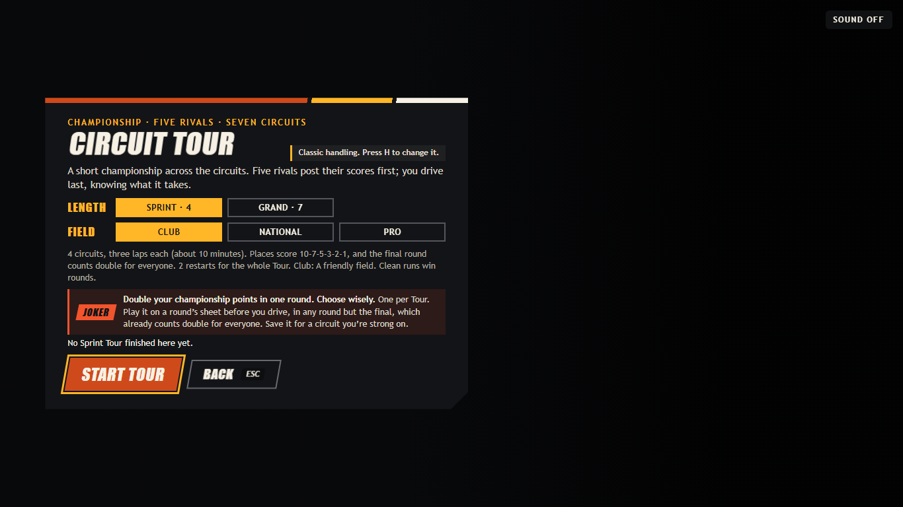
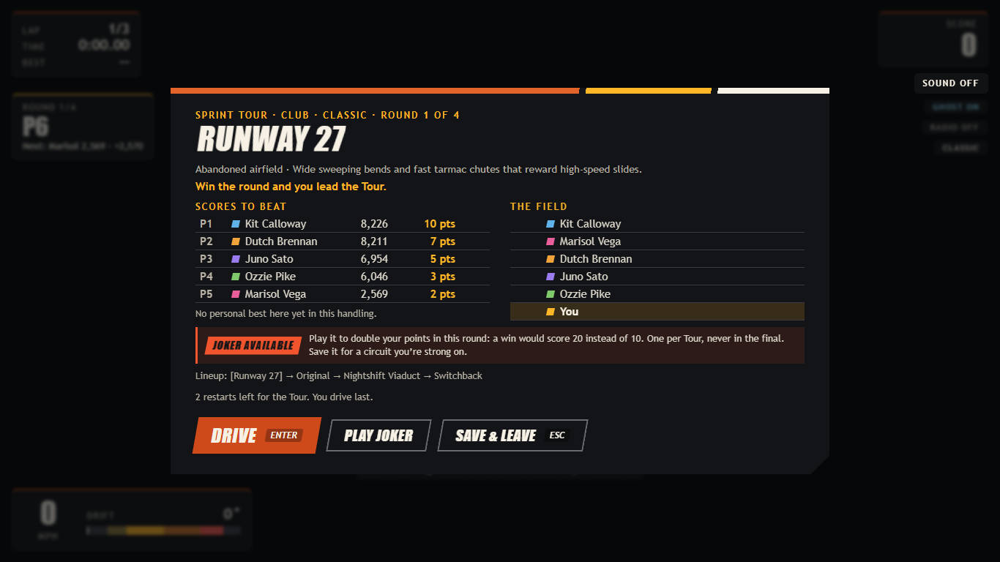
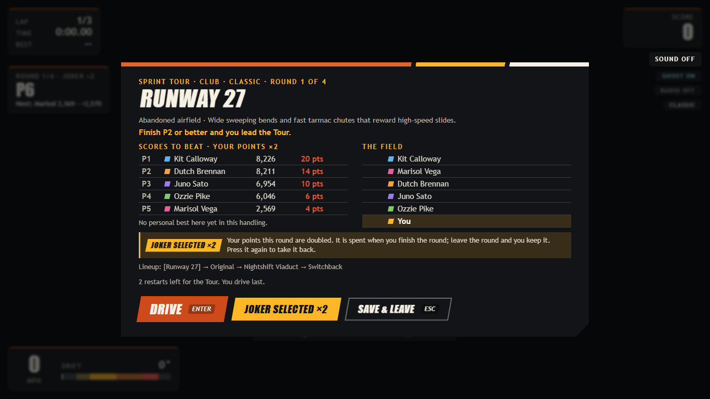
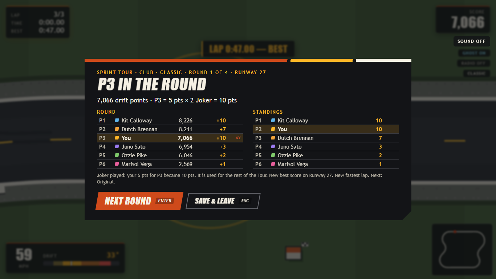
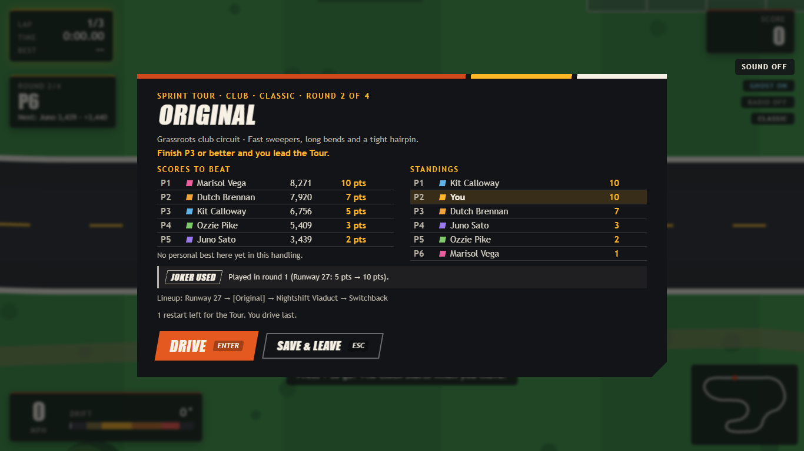
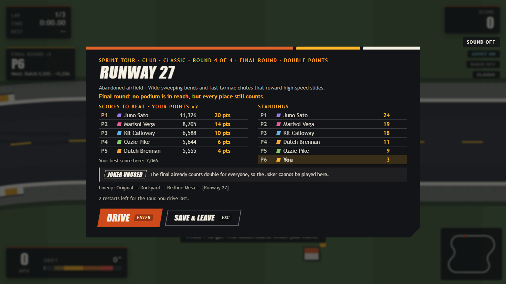

# Circuit Tour

Circuit Tour is a short championship across the seven circuits, new in v0.9.0. Five fictional
rival drifters post their scores for each round before you drive. You always drive last, knowing
exactly what it takes. Your finishing place earns championship points, and a table is kept across
the rounds.

Open **Circuit Tour** from the title screen. No setting or address switch is needed.



## The rules

- **Length.** A **Sprint Tour** is 4 circuits, about 10 minutes. A **Grand Tour** is all 7
  circuits, about 20 minutes. The circuits are drawn at random from all seven, with no repeats, and
  the full lineup is shown on every round sheet.
- **Field.** **Club**, **National** or **Pro**. The same five rivals appear in each, in better form
  as the field gets stronger.
- **Handling.** The Tour takes Classic or Power from the title when it starts and keeps it for
  every round. **H** on the Tour sheet changes it before you start.
- **Each round is an ordinary three-lap circuit run.** It uses the same physics, drift scoring,
  combo banking and lap validation as a run from the Tracks menu. The Tour reads only the run's
  final counted score, the same score the results screen would show.
- **The field posts first.** Before each round, the round sheet lists the five posted scores and
  what each finishing place is worth. During the run, the HUD shows your place among the rivals,
  the next score to beat and the gap to it. When banking the combo you're holding would move you
  up, it shows **Bank it → P2**. Passing a rival pops a banner.
- **Points by finishing place**, out of six drivers: **10, 7, 5, 3, 2, 1**. To beat a posted score
  you must score strictly more than it. A tie leaves you behind.
- **The final round counts double for everyone.**
- **The Joker** doubles your own points in one round. See below.
- **Each round sheet says what the round decides**, worked out from the posted scores. For example:
  *Finish P2 or better and you lead the Tour*, or *Final round: you are champion if you finish P3
  or better*.
- **The championship.** The table adds up the points. Ties are broken by more round wins, then more
  second places and so on, then the higher total drift score. Finishing P1 to P3 overall wins a
  gold, silver or bronze trophy.

## The Joker

**JOKER: Double your championship points in one round. Choose wisely.**

| | |
|---|---|
| What it does | Doubles **your** championship points for one round. The rivals' points are never doubled. |
| How often | **Once per Tour.** |
| When | On a round's sheet, **before you drive**, choose **Play Joker**. Choose it again to take it back. Once you press **Drive**, it is set for that round. |
| Where not | **Not in the final round.** The final already counts double for everyone, so no round is ever worth more than double. |
| When it is spent | When that round's result is recorded. The Joker stays available if you leave the round (Save & leave, or Leave mid-run), close the page, or the round ends as a DNF. A restart within the round keeps it selected. |
| Why save it | A win with the Joker is worth 20 instead of 10, so it earns the most on a round where you expect a strong drive. The round sheet warns you when you reach the last round it can be played. |

The game explains the Joker in three places:

- **On the Tour sheet:** a rules card with the headline above and the full rules.
- **On every round sheet:** a Joker panel whose badge shows the Joker's state:

  | Badge | Meaning |
  |---|---|
  | **Joker available** | Unplayed, and it can be played in this round. The text says what a win would be worth with it. |
  | **Joker · last chance** | The last round before the final, so the last round it can be played. |
  | **Joker selected ×2** | Chosen for this round. The *Scores to beat* column shows each place's points doubled, and the HUD shows *Joker ×2* while you drive. |
  | **Joker used** | Already played. The panel names the round and circuit and what it turned into, for example *7 pts → 14 pts*. |
  | **Joker unused** | The final round, with the Joker never played. It can't be played here. |

- **On the round result:** the points line spells out the multiplication, for example
  *P2 = 7 pts × 2 Joker = 14 pts*, or *P1 = 10 pts × 2 final = 20 pts* in the final. Your row in
  the round table is marked **×2**. The Tour menu's Continue box and the final sheet say whether
  the Joker was used, and where.







To play the Joker:

- **Keyboard:** Up and Down (or Tab) reach **Play Joker**. Enter or Space presses it.
- **Mouse:** click it.
- **Controller:** D-pad to it, then press A.

The Joker has no key of its own.

## Restarts, leaving and resuming

This is the human-tested R2 policy, unchanged:

- **Restarts belong to the whole Tour:** 2 in a Sprint, 3 in a Grand.
- **R on the grid is free.** Once the car has moved, **R uses one of the Tour's restarts**, and the
  banner says how many are left. With none left, R does nothing and says so.
- **Leaving from a round sheet or from the grid is free** (Esc, or **Save & leave**). The Tour is
  saved, and **Continue** on the Tour sheet picks it up.
- **Leaving once the car has moved uses a restart**, and the round is driven again. Closing the
  page while driving counts as leaving, and the cost is charged when you continue the Tour. With no
  restarts left, leaving ends the round as a **DNF**: last place and no points. The pause sheet's
  buttons say what each will cost: *Restart (1 left)*, *Leave (uses a restart)* or *Leave (DNF)*.
- **Between rounds**, Esc or **Save & leave** keeps the Tour for later.
- **Retire** on the Tour sheet ends the Tour in progress. A retired Tour is kept in history and
  earns no bests. Starting a **New Tour** while one is in progress retires it the same way.

## The end of a Tour

The final sheet shows:

- the final standings, with a trophy for a championship podium
- your rounds, with the Joker round marked ×2
- whether and where the Joker was used
- your Tour bests for those settings (Tours finished, titles, best finish and best points), kept
  for each length, field and handling mode

Its buttons:

- **Rematch** plays the same circuits in the same order against the same posted scores, with a
  fresh Joker and fresh restarts. In other words, the Tour code shown on the sheet is played again.
- **New Tour** draws new circuits and posted scores with the same settings.
- **Tour menu** goes back to the Tour sheet.

## Records, ghosts, audio and analytics

- **Records.** A Tour round is a normal three-lap run, so it can set the ordinary circuit records
  (score, combo and fastest lap for its circuit and handling mode) and save reference ghosts,
  exactly as a run from the Tracks menu would. That's deliberate: the driving rules are identical,
  and the Tour's own rules (limited restarts) can only make a run harder. A round's result notes a
  new best score or fastest lap. The Tour never writes to the keys of the records, ghosts,
  Gymkhana, Getaway or preferences itself.
- **Ghosts.** The ghost choice in Options (Previous Lap, Saved Reference or Off) applies to Tour
  rounds as to any circuit run, and G still shows or hides the ghost.
- **Audio.** Engine, tyres, radio and effects work as in any circuit run. Choosing the Joker and
  passing a rival play cues, and the last round ends on the Tour's trophy sting.
- **Analytics.** A Tour round is counted exactly like a Tracks run: one `md_run_start` and, if it
  finishes, one `md_run_complete`, both with `{ category: 'tracks' }`, plus the usual lap
  milestones. Nothing about the Tour itself is sent. See [ANALYTICS](ANALYTICS.md#circuit-tour).

## Storage

Circuit Tour keeps one key of its own, **`mini-drifters-tour-v1`**:

```
{ version: 1,
  active:  <the Tour in progress, as src/tour.js makes it, plus `driving`> | null,
  history: [ <the last 12 finished or retired Tours: settings, outcome, each round> ],
  bests:   { "<length>|<field>|<handling>": { finished, champion, podium, sweeps,
                                              bestPlace, bestTrophy, bestPoints } } }
```

A saved Tour carries everything about itself: its seed and code, the lineup, every posted score,
the results so far, the restarts left, the round the Joker was played in (`jokerRound`) and its
rules id (`tour-1`). A saved Tour never changes, even if the game's Tour code later does.

- **Rules, as in `src/records.js`.** Nothing is written on load. Every write re-reads the key first.
  Data from a later store version is kept and never written over. Damaged data reads as empty and
  is replaced by the next Tour. A saved Tour that fails `isTour` (other rules, or damaged) is set
  aside, never resumed, and the sheet says so.
- **Other tabs.** A round's result is written only if the stored Tour is still the same Tour at the
  same round. A second tab can't overwrite a Tour that has moved on, and the sheet says the Tour was
  carried on elsewhere.
- **Denied or full storage.** The Tour plays on in that window, the Joker and points still count,
  and the sheets say the Tour can't be saved or resumed.
- **Research saves.** The v0.9.0 R2 research build used `mini-drifters-r2-tour`. Production never
  reads, writes or migrates that key, so research Tours stay where they were and don't appear here.
- No other key is read or written.

## Architecture

| File | Role |
|---|---|
| `src/tour.js` | Pure rules: the lineup, rivals, what a round is worth, standings, stakes, the Joker (`jokerState`, `pointsBreakdown`) and the double final, restarts and leaving, the outcome, and validation of saved Tours (`isTour`). It uses no browser APIs, storage, clock or `Math.random`: a Tour is decided by its seed. It imports only `track.js`. |
| `src/tour-store.js` | The Tour's storage (above). Imports only `tour.js`. |
| `src/tour-ui.js` | Draws the Tour sheet, round sheet and Joker panel, round result, final sheet and HUD panel, and nothing else. |
| `src/main.js` | The wiring. A round is started with `startRun` like any circuit run, with the round sheet over the paused grid, and the run's `finish` event hands `game.results.score` to `recordRound`. |
| `index.html`, `style.css` | The title button, the HUD panel and the four Tour sections. |

The Tour leaves the physics, tuning, handling, scoring, laps, tracks, records, ghost store,
Gymkhana, Getaway, practice pad and lesson unchanged.

## Calibration

`PAR` in `src/tour.js` is the scripted median counted score for each circuit and handling mode,
from the R2 research sweep of 3,584 scripted three-lap runs. It sets each circuit's relative scale,
so neither a circuit's length nor the handling mode decides a Tour. Each rival posts
`PAR × field scale × their level`, with their own run-to-run spread, an occasional blunder and
favourite circuits. The field scales are Club 0.95, National 1.3 and Pro 1.7. The owner played the
R2 research build and accepted the championship as tuned, so these are the release values.

### Why finishing places, not drift totals

From the research sweep:

| | Raw drift total | Normalised (score ÷ PAR) | Finishing places |
|---|---|---|---|
| Share of a Grand Tour decided by each circuit (ideal 14%) | 6–27% (Runway 27 and Original dominate, Dockyard and Redline Mesa barely count) | 10–20% | 12–16% |
| Same player, Power ÷ Classic | ×1.34 | ×1.06 | even at mid skill |
| One 3× round + three 0.6× rounds vs 1.2× every round | tie | tie | 0% vs 74% titles |
| Ranks players by true skill (single run: 0.52–0.64) | 0.75–0.89 | 0.76–0.89 | 0.70–0.85 |

A finishing place carries a little less skill signal than a normalised total. In return, it treats
every circuit and both handling modes alike, rewards driving well everywhere, and gives the
standings that the rest of the design is built on. In Sprint Tours, the double final raised the
share of Tours whose title is still undecided in the last round from 41–47% to 71–75%.

## History

- **v0.9.0 R2 (research build).** Built behind `?research=tour` on `research/v0.9.0-r2-circuit-tour`
  (`e5a5a33`), with two formats: the Championship and a Targets alternative (fixed Gold, Silver and
  Bronze scores, no rivals). The research report recommended the Championship.
- **v0.9.0 R3 (production).** The owner accepted the Championship after human testing and asked only
  for a clearer explanation of the Joker. R3:
  - made the Tour a title-menu mode
  - removed the Targets format and the research comparison line
  - added the Joker rules card, the round panel and the points breakdown
  - moved storage to `mini-drifters-tour-v1`

  The championship rules are R2's, unchanged. A unit test pins a fingerprint of 20,400 lineups,
  posted scores, stakes, standings and outcomes taken from the R2 build.

## Tests

- `test/tour.test.mjs` covers the rules:
  - the R2 fingerprint, and that no research format survives
  - the tables, purity, lineup variety and rival scaling
  - points, standings, stakes and the double final
  - the Joker's states, breakdown and persistence (only a recorded round spends it)
  - restarts and leaving, and that skill decides a Tour
  - the storage contract, including research-key isolation
  - that a Tour round is a normal run that sets the ordinary records
- `test/tour-browser.mjs` (`npm run test:tour:browser`) runs in Chromium and Firefox and covers:
  - the title button, with no URL switch
  - the Tour sheet and its Joker rules card
  - whole rounds driven by the scripted driver
  - every Joker state, and the Joker by mouse, keyboard and controller
  - paid and free restarts, leaving, a reload while driving and running out of restarts
  - the double final, Rematch and Retire
  - damaged data, research-save isolation and denied storage
  - fit at 1024×600, 1280×720, 1366×768 and 1920×1080
- `test/analytics-browser.mjs` drives a Tour round on the published address and checks that it is
  counted once as a `tracks` run, with nothing about the Tour sent.

All three are registered in `scripts/ci/test-plan.config.mjs`.

## Known limitations

- The rivals are posted scores, not cars on the track.
- The calibration comes from scripted drivers. The owner's playtest found it fair, but a wider
  audience may find a field too easy or too hard on some circuits.
- Lap counts are fixed at the game's three, and lineups are drawn, not chosen.
- A player can keep starting new Tours until round 1's posted scores look easy. Later rounds'
  posted scores aren't shown until those rounds are reached.
- The Tour menu shows the Tour in progress and the bests. History is kept but not yet shown.
- Tours are saved in this browser only, like every other record.
